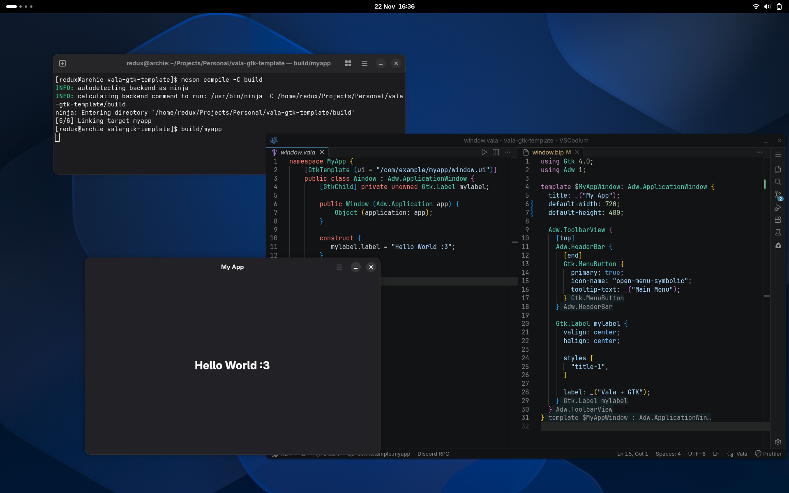

# Vala + GTK template

Minimal template to create a Vala + GTK application with support for blueprint files and flatpak packaging.



## Getting Started

There's two ways to build and run the project, you can either use Meson alone and build a classic binary or use the provided .json file to build a Flatpak package that allows you to run the app sandboxed.

### Meson only

First install all the required dependencies for your system using the following commnad:

#### Debian-based


```bash
apt install meson valac libgtk-4-dev libadwaita-1-dev blueprint-compiler
``` 

#### Arch-based

```bash
pacman -S meson vala gtk4 libadwaita blueprint-compiler
```

#### Fedora-based

```bash
dnf install meson vala gtk4-devel libadwaita-devel blueprint-compiler
``` 

---

Then you can setup meson by running the following command:

```bash
meson setup build
``` 

To compile the app you can run:

```bash
meson compile -C build
```

> [!TIP]
> The build argument is the directory where meson stores the build artifacts including the app's binary, if you'd like to use a different name you're free to change it in the build command. Keep in mind that you'll also need to change it in the compile command.

To run the built binary you can run the following command:


```bash
build/myapp
```

> [!NOTE]
> `myapp` is the name of the application binary, later in this document you'll learn how to change it including the package ID and version.

And you're done! Everytime you make a change to the code you rerun the compile command and run the binary inside build.


### Flatpak


To build and run using Flatpak you'll additionally need to install the following packages:

```bash
your-package-manager flatpak flatpak-builder
```

Install the SDKs:

```bash
flatpak install flathub org.gnome.Platform//51 org.gnome.Sdk//51
```

You can then run the install command, this is similar to the meson compile command but it also install the application as a flatpak

```bash
flatpak-builder --user --install --force-clean build-flatpak com.example.myapp.json
```

> [!TIP]
> Similar to meson, build-flatpak is the directory flatpak-builder uses to store the build artifacts, additionally the final argument is the flatpak manifest file that tells flatpak-builder the basic metadata of your application, required modules, and how to build it. This file is also used to specify what permissions your app requires.

After installing the application you can use the following command to run it:

```bash
flatpak run com.example.myapp
```

> [!NOTE]
> `com.example.myapp` is the id value inside the manifest file, if you changed the id in the manifest file you should run the app with the new value.


## Resources

- [Vala documentation](https://docs.vala.dev/)
- [Meson quickstart guide](https://mesonbuild.com/Quick-guide.html)
- [Flatpak Builder documentation](https://docs.flatpak.org/en/latest/building-introduction.html)
- [libadwaita documentation](https://gnome.pages.gitlab.gnome.org/libadwaita/doc/1-latest/)
- [GTK documentation](https://docs.gtk.org/gtk4/)
- [Blueprint documentation](https://gnome.pages.gitlab.gnome.org/blueprint-compiler/)